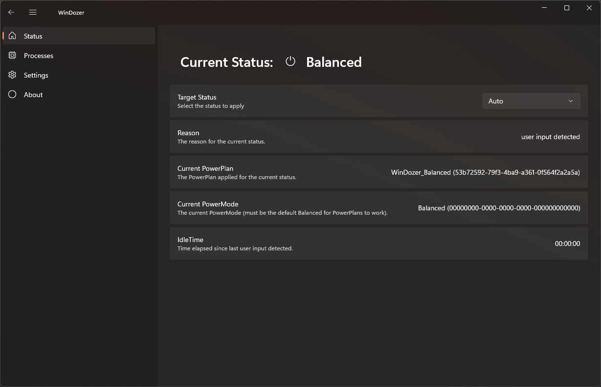
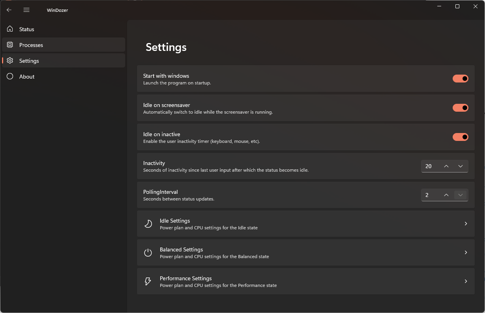
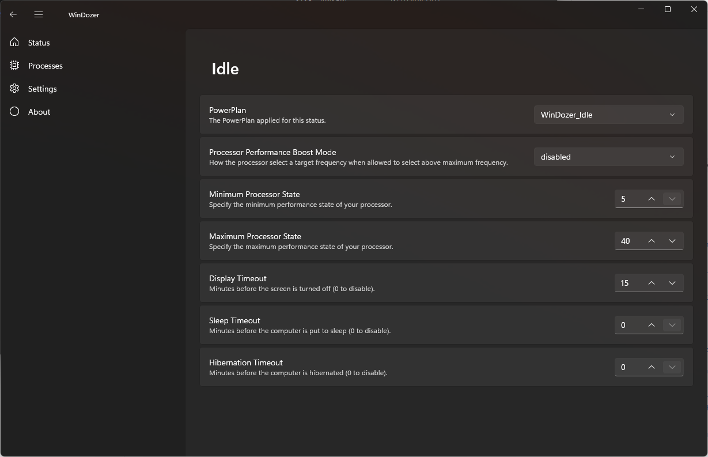

# WinDozer

A small Windows tray utility that automatically switches the active power plan depending on what you are doing: which applications are running and whether you are at the keyboard.

It is mainly meant for gaming laptops and desktop replacements, where CPU boost is rarely needed but temperature, fan noise and power draw matter during everyday use. Assign the programs that need more power to the *Balanced* or *Performance* lists, and the machine drops to a cool, frugal *Idle* plan when you step away.

> WinDozer was previously called **PowerPlanManager**.

## How it works

The app checks the system every few seconds and picks one of three states, in this order of priority:

| Priority | Condition | State |
|---|---|---|
| 1 | A process from the **Performance** list is running | Performance |
| 2 | A process from the **Balanced** list is running | Balanced |
| 3 | No keyboard/mouse input for the configured time (default 20 s), or the screensaver is running | Idle |
| 4 | Otherwise (you are using the computer) | Balanced |

Each state has a Windows power plan assigned to it. When the state changes, the app activates that plan. Switching only happens when the state actually changes, so you can still change plan manually in Windows and it will stay until the next state change.

## Features

- Automatic switching by **running applications** and **user inactivity** (input timeout and screensaver detection, both optional).
- **Drag and drop process lists**: running processes that are not assigned yet appear on one side, and you drag them into the Balanced or Performance list. You can also add a process by name, even if it is not running right now.
- **Manual override**: force Idle, Balanced or Performance from the UI or the tray icon, or go back to Auto.
- **Tray icon** that changes with the current state.
- Runs in the background and can **start with Windows**.
- **Single instance**: launching the program again just brings up the existing window.
- Use the **built-in managed plans** or **select any existing power plan** for each state.
- Warns you when the new Windows 10/11 **power mode** (the slider in Settings) is not set to *Balanced*, because power plans only take effect in that mode, and offers a one-click reset.

## Managed power plans

The program can create three plans of its own, called `WinDozer_Idle`, `WinDozer_Balanced` and `WinDozer_Performance`. Their default values are:

| | PPM_Idle | PPM_Balanced | PPM_Performance |
|---|---|---|---|
| Max CPU frequency | 40% | 100% | 100% |
| CPU boost | disabled | disabled | enabled |
| Screen timeout | 15 min | 15 min | never |
| Sleep timeout | 30 min | never | never |

Idle keeps the CPU cool and quiet. Balanced gives full base performance without boost clocks, which keeps temperatures down. Performance has no restrictions, and the computer and monitor stay on as long as it is active.

Creating these plans is optional. You can point each state at any plan already on your system, for example the stock *Power saver*, *Balanced* and *High performance*. The screen and sleep timeouts above are only written to the managed plans, never to your own.

## Requirements

- Windows 10 (version 1809 or later) or Windows 11.
- Built with WinUI 3 (Windows App SDK) as an **unpackaged** app. See the project file for the exact .NET and Windows App SDK versions.

## Installation

Download the latest build from the [Releases](https://github.com/eliosteva/WinDozer/releases) page, extract it somewhere, and run the executable.

Because the app is unsigned, Windows SmartScreen may warn you the first time you run it.

### Where data is stored

- Settings: `%LocalAppData%\ElioSoft\WinDozer\WinDozer.ini`
- Log: `WinDozer.log` in the working directory of the program.
- Autostart: a value under `HKCU\Software\Microsoft\Windows\CurrentVersion\Run`, only present while autostart is enabled.

### Uninstall

1. Turn off autostart in the app, then run the uninstaller.
2. Delete the program folder and `%LocalAppData%\ElioSoft` (optional).
3. If you installed the managed plans and want them gone, remove them from the control panel.

## Notes and limitations

- Process names are matched exactly as Windows reports them: **without** `.exe` and **case sensitive** (`chrome`, not `Chrome.exe`). Dragging a process from the running list always creates a correct entry.
- Power plans are applied only while the Windows power mode is *Balanced* (see the warning in the app).
- Idle detection uses the last-input time of the current user session, so the program runs as a normal tray app and not as a Windows service.

## Disclaimer

The software is provided "as is", and you use it at your own risk. It is developed and tested on a PC with an AMD CPU running Windows 11, so behavior on other hardware may differ. Changing power plans affects CPU frequency, sleep and display timeouts, so check that the values suit your machine.

## License

Released under the [GPL-3.0 license](LICENSE).
